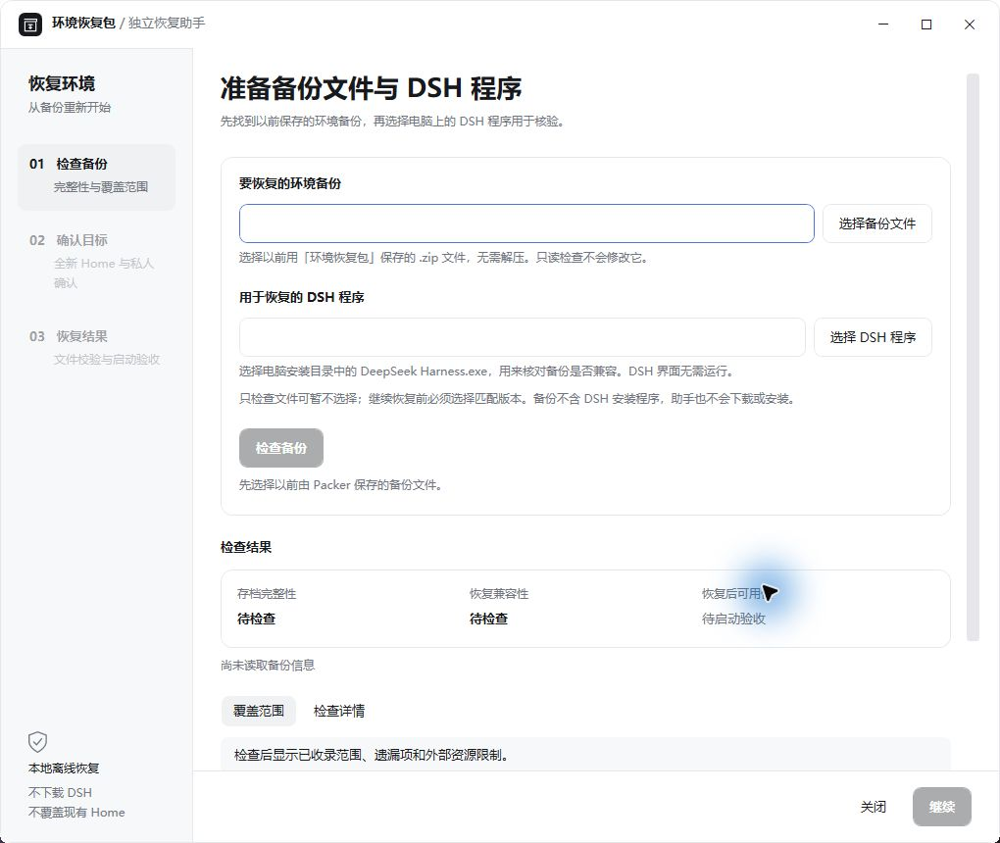

# DSH Environment Packer

> This branch is the **unpublished v0.6.0 Phase 2 candidate**. See [the migration channel guide](docs/MIGRATION.md) for the new archive and two-path recovery. The v0.5.0 download and steps below describe the published baseline, not a release of this candidate. Strict restore retains its original rules.

[简体中文](README.md) · [Download v0.5.0](https://github.com/379385796-sys/dsh-environment-packer/releases/tag/v0.5.0) · [Restore guide](docs/RESTORE.md) · [Compatibility](docs/COMPATIBILITY.md)

**Local offline cold backup and disaster recovery for DSH.** Back up the current Profile and selected Home data after DSH quits normally, independently inspect the ZIP, and restore into a fresh compatible environment. This is not a daily configuration manager or synchronization service.

**Private ZIPs may contain keys, tokens, passwords, prompts, conversations and attachments. They are not encrypted. Never publish them or attach them to issues.**

## Download, verify and install

Accepted target: Windows 11 x64 / DSH Desktop **0.2.1-rc.5**. Recovery on arbitrary DSH versions or computers is not promised.

1. Download `dsh-environment-packer-0.5.0.tgz` and its `.sha256` from the [v0.5.0 Release](https://github.com/379385796-sys/dsh-environment-packer/releases/tag/v0.5.0).
2. Compare the downloaded file with the checksum:

   ```powershell
   Get-FileHash -Algorithm SHA256 -LiteralPath '<absolute downloaded tgz path>'
   ```

3. Test in an isolated Profile first. Before a production upgrade, normally quit all DSH instances and back up the current Profile and previous package. With the configured official CLI:

   ```text
   dsh plugin --profile <profile> add <absolute tgz path>
   ```

4. Restart, open **Settings → Environment recovery package**, and verify `0.5.0`. The other plugins used in acceptance are not required. No npm publication.

Accepted package SHA-256:

```text
b301efa06bcb2b589e382c5a7c20ee07292e9899b4f34a452e1fd6faac84db11
```

## Create a cold backup

1. Choose “Create complete environment backup (offline)”, an existing output folder and a new ZIP filename.
2. Save your work, approve the private-data warning and wait for the independent cold-backup helper to acknowledge handoff.
3. **Normally quit every DSH instance using its menu or tray.** Closing a window may leave it running.
4. Click “I have quit normally; check and continue”. Process, quiescence and file read-lease checks still apply; confirmation cannot bypass them.
5. Wait for writing, CRC/Manifest/per-file SHA-256 verification and safe completion. Retain the ZIP and checksum. DSH is not restarted automatically.

Existing ZIPs are never overwritten. Active writers, uncertain safety, lease failures and timeouts stop the operation. Abnormal-task recovery retains logs and unconfirmed artifacts; backups are not automatically deleted. See [legacy task recovery](docs/LEGACY-RECOVERY.md).

## Recover when DSH cannot start

Retain **the private ZIP, complete compatible Packer toolkit, matching DSH installation, and excluded external resources**. A ZIP alone does not guarantee future recovery.

Extract the trusted tgz (Windows tar supports `tar -xzf <tgz> -C <existing-tool-directory>`) and keep the entire `package` folder. Open **`bin/restore-assistant.exe`** inside it; do not copy the EXE alone. The WPF assistant uses installed Windows .NET Framework/WPF and PowerShell assemblies. It runs without the DSH interface, adds no downloaded desktop runtime and opens no PowerShell console.



1. Select a ZIP previously saved by Packer. Read-only inspection does not extract, install or execute plugins.
2. Select the trusted installed `DeepSeek Harness.exe` for background runtime and exact host-proof checks. It does not open the DSH interface.
3. Once checks pass, choose a nonexistent fresh Home, review scope and explicitly confirm private restoration.
4. Execution revalidates the ZIP, host, dependencies, paths and destination. Existing Homes are never merged or overwritten; recognized production Homes are refused.
5. After file restoration, start the matching DSH with the new Home and a separate agents directory, normally quit and restart, then verify plugins, conversations and external paths.

**Archive integrity, recovery compatibility and post-restore usability are separate results.** Valid hashes do not prove complete business-data coverage. Restored files do not prove that DSH works. Failed checks cannot be skipped. See the [full guide and CLI](docs/RESTORE.md) and [preparation checklist](docs/RECOVERY-PREPARATION.md).

## Coverage and exclusions

| Scope | Included or excluded |
| --- | --- |
| Current Profile | Regular files, plugins, dependencies and local packages; no duplicate `.pnpm` virtual store. Package-root links are materialized; unsafe data links are refused. |
| Home allowlist | Existing `storages`, `sessions`, `attachments`, `memory`, `skills`, `AGENTS.md`, `.credentials.yaml/.yml`. |
| Excluded | Other Profiles, unknown Home items, external workspaces/models/databases, DSH installer, system/browser credentials, original ACLs/ownership/ADS. |

Coverage reports show captured files, omitted items, exclusions and identified external references; they cannot identify every business dependency. Stop external database/writer processes normally. The GUI requires a Profile under `DSH_HOME/profiles/<name>`. Limits: 128 MiB per file, about 2 GiB payload, 59,999 files plus directories. Exceeding limits or unsupported link layouts fails safely.

## Compatibility, acceptance and license

Existing private `recovery/2` and `recovery/3` formats remain supported, subject to platform, architecture, exact DSH version, Node major and ABI requirements. Format 3 also checks exact host files and dependency proofs; the same version label alone is insufficient. Legacy 0.3.4 declaration ZIPs and safe-configuration exports cannot restore a full environment.

Synthetic acceptance includes real Desktop cold backup, independent WPF restoration, restored-Home Desktop startup/restart and four-plugin joint operation. **Cross-device migration, real private-database business restoration, network volumes and every DPI/antivirus configuration remain unverified.** ACLs are not encryption; hashes are not signatures.

[Compatibility boundary](docs/COMPATIBILITY.md) · [Upgrade/rollback](docs/UPGRADE-ROLLBACK.md) · [Build/tests](docs/BUILD-TEST.md) · [Changelog](CHANGELOG.md)

[MIT](LICENSE) covers maintainer-controlled contributions. Original js-yaml MIT, semver ISC and [third-party notices](THIRD_PARTY_NOTICES.md) remain. [Provenance](docs/PROVENANCE.md) discloses historical limitations without fabricating missing development history.
