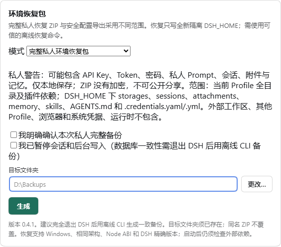
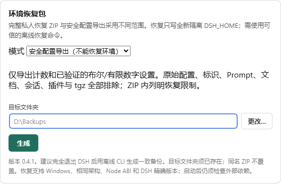

# DSH Environment Packer 0.4.1

[中文](README.md) · [Compatibility](docs/COMPATIBILITY.md) · [Source provenance](docs/PROVENANCE.md)

A local DSH backup and isolated restoration plugin, with a separate conservative configuration export. It is not a universal one-click lossless migration tool.

## Privacy boundaries

**A full private ZIP may contain API keys, tokens, passwords, private prompts, sessions, attachments and memory. The ZIP is not encrypted and is unsuitable for public sharing.** Confirmation is required for each backup; it stays local. Never upload a private ZIP, real Profile or credentials to an issue.

The full mode preserves the selected Profile's regular files, configuration, installed plugins/dependencies and local packages. Package-root dependency links are materialized; data links and cycles fail closed. Selected home roots: storages, sessions, attachments, memory, skills, AGENTS.md and .credentials.yaml/.yml when present. External workspaces/programs/models, other Profiles, browser/OS credentials, runtimes, original ACLs and NTFS ADS are excluded. The manifest records files, hashes and limitations.

The safe mode is **not an environment restore**. It exports only counts, smooth-stream.enabled as a boolean, and ui-appearance.fontSize as a finite 8–48 number. Raw configurations, arbitrary strings/identifiers/paths/versions, prompts, documents, sessions, attachments, memory, plugin files and tgz archives are excluded. It does not claim to sanitize arbitrary user files.

## Install and use

Download the tgz and SHA-256 file from [v0.4.1](https://github.com/379385796-sys/dsh-environment-packer/releases/tag/v0.4.1), verify the hash and select the tgz in DSH's local plugin installer. Restart the host and open Settings → Environment recovery pack. This project is not published to npm; private:true prevents accidental npm publication.

For an existing link/Junction installation, fully exit DSH and back up the source, link target and file list before deploying verified files. Do not modify a live target or overwrite an entire Profile. See [upgrade/rollback](docs/UPGRADE-ROLLBACK.md).

Choose a mode and an existing output directory. Read and confirm each private backup. Existing ZIPs are refused. Manual directory input remains available if native dialogs are unavailable. Native Save As was exercised by a human on the Windows desktop for cancellation, Unicode paths, no-overwrite and safe export; missing automation enumeration alone does not prove a dialog failed to open.





**For database consistency, completely stop DSH and use the offline CLI.** GUI quiescence confirmation and file-change checks cannot establish multi-file transaction consistency.

## Offline restoration

Use the trusted restore helper from the installed package, not a script from an unfamiliar ZIP. The target must be a new, nonexistent DSH_HOME with an existing parent. No overwrite or merge mode exists. Install matching DSH and external dependencies first.

```text
node bin/backup-private.mjs --home <SOURCE_HOME> --profile <SOURCE_PROFILE> --zip <EXISTING_FOLDER/private.zip> --dsh-version 0.2.1-rc.2 --confirm-private --source-quiescent
node assets/restore-private.cjs --zip <PRIVATE_ZIP> --home <NEW_HOME> --profile-name restored --dsh-version 0.2.1-rc.2 --confirm-private
```

Use the source DSH's compatible runtime, not an arbitrary system Node. Tested: Windows x64, DSH Desktop 0.2.1-rc.2, its Electron Node 24.21.0 / ABI 149. Its executable can run these scripts with process-local ELECTRON_RUN_AS_NODE=1 and --expose-internals. See [restore instructions](docs/RESTORE.md).

The helper checks the complete entry set, paths, CRC and SHA-256 before staging writes, verifies the restored files and commits a fresh home. No network, pnpm, tar.exe or lifecycle scripts are used. Boot the new home separately and validate actual plugin functionality and external paths afterwards.

## Limits

- Legacy 0.3.4 directory/declaration formats are incompatible; no automatic conversion. 0.4.0 and 0.4.1 private ZIPs share a format and cross-patch restoration was tested.
- Private Windows ACLs are not encryption. Hashes are not signatures. Local TOCTOU and hard-exit residue limits remain.
- Limits: 128 MiB per file, about 2 GiB payload, 59,999 files plus directories. Oversize inputs or cyclic dependency links fail rather than silently truncate.
- External file/link sources, absolute paths, runtimes and OS/browser credentials need separate migration. The preserved lockfile does not imply a frozen offline pnpm reinstall.
- Another machine/VM, real private database restoration, arbitrary versions, network/OneDrive paths, all DPI/multi-monitor/antivirus conditions and all external dependencies were not validated.

## Validation and licensing

Synthetic backup/restore, exact hashes, host startup/restart and negative paths were tested. 0.4.1 fixes restoration counters without a progress callback. [Build/test details](docs/BUILD-TEST.md).

[MIT](LICENSE) applies to maintainer-controlled contributions; js-yaml retains Vitaly Puzrin's MIT notice. See [third-party notices](THIRD_PARTY_NOTICES.md). Early development records are incomplete; this is not an exclusive historical authorship claim. [Provenance](docs/PROVENANCE.md).
