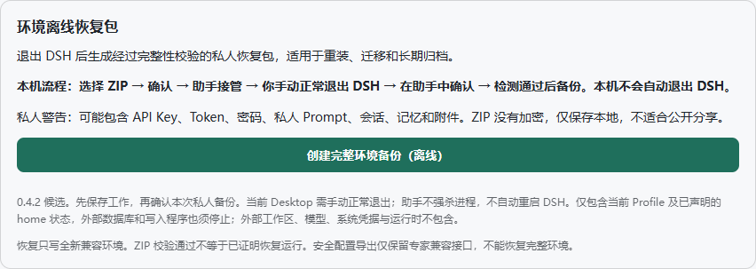

# DSH Environment Packer 0.4.3（本地候选）

[English](README.en.md) · [兼容范围](docs/COMPATIBILITY.md) · [恢复](docs/RESTORE.md) · [来源与许可](docs/PROVENANCE.md)

面向重装、迁移和灾难恢复的低频本地离线冷备份工具。0.4.3 为尚未部署、尚未发布的本地恢复机制候选版。正式 0.4.2 保持原状；验收后再决定是否安装候选包。不是所有 DSH 环境通用的一键无损迁移器。

## 创建完整环境备份（离线）

1. 在设置 → 环境恢复包点击主按钮，使用 Windows Save As 选择已存在的文件夹和新 ZIP 文件名。
2. 保存未完成工作，阅读私人范围及外部写入者警告，确认本次备份。取消不会创建任务。
3. 等待“独立助手已接管”和自动显示的独立进度窗口。交接失败时保持 DSH 运行。
4. **你手动通过菜单或托盘正常退出所有 DSH 实例**。当前 Desktop 没有安全的插件退出接口，不会自动退出或强杀；仅关窗口可能隐藏到托盘。
5. 在助手点击 **“我已正常退出，检查后继续”**。点击不能绕过检测：只有相关进程完全退出且持续静止，才会开始扫描。无法确认或 10 分钟超时就安全停止。
6. 助手锁定载荷文件防止写入/删除，生成 ZIP 并校验条目集合、CRC、清单和全部载荷 SHA-256。阶段、文件数量及活动条持续显示，不虚构百分比。
7. 成功后查看路径、大小、SHA-256 和清理结果，可打开所在文件夹。不会自动重启 DSH。

原生窗口不可用时才显示完整 ZIP 路径输入后备。现有目标拒绝覆盖。重复点击不会创建竞争任务；异常中断遗留的任务锁需先检查现场，不自动抢占。

## 私人数据与范围

**ZIP 可能包含 API Key、Token、密码、私人 Prompt、会话、记忆和附件。ZIP 没有加密，仅本地保存，不适合公开分享。** 不上传云端；不要将 ZIP、配置或任务私有记录附在 issue。

GUI 要求 Profile 位于所选 DSH_HOME/profiles/<name>，非标准外置 Profile 会安全拒绝。范围：当前 Profile 全部常规文件和目录，包括插件、依赖和本地 tgz；安装包根链接物化，循环或数据链接安全失败。另包含所选 DSH_HOME 的 storages、sessions、attachments、memory、skills、AGENTS.md、.credentials.yaml/.yml（存在时）。清单记录实际范围、逐文件哈希及排除。

不包含其他 Profile、未声明的 home 项、外部工作区/模型/程序、系统或浏览器凭据、运行时、原 ACL/所有者/ADS。外部数据库和其他写入程序须正常停止；不保证外部状态被迁移。助手会保守等待同一 Desktop 运行时的所有实例、已跟踪后代、引用源 home 的进程及已知数据库进程。文件读锁失败就停止。

Windows 私人 ACL 仅限当前用户/SYSTEM；这不是加密。任务参数、载荷路径请求及临时目录受私有 ACL 保护；普通状态只记录阶段、计数、布尔结果与受控错误码，不存原始配置。已完成任务记录留在 DSH_HOME/.packer-cold（不在备份范围）。

## 专家接口与恢复

普通 GUI 没有运行中完整备份入口，旧 POST /create-full 固定返回 410 HOT_BACKUP_DISABLED。专家安全导出兼容接口 /create 保留，只导出严格类型化的少量计数、布尔和有限数字；**不能恢复环境**，不会导出原始配置、Prompt、插件或 tgz。

离线专家 CLI 保留 bin/backup-private.mjs；须显式指定 --home、--profile、--zip、--dsh-version、--confirm-private、--source-quiescent。它在开始及提交前检测已知写入者，仍要求操作者确实停止外部写入。普通用户无须输入 Node 命令。

恢复使用可信安装包 assets/restore-private.cjs，参数 --zip、--home（不存在的全新目标）、--profile-name、--dsh-version、--confirm-private。没有覆盖/合并选项，不运行安装脚本或联网安装依赖。具体运行时与命令见 [恢复说明](docs/RESTORE.md)。**ZIP 校验通过不等于已证明环境恢复运行**，恢复后必须另做宿主与业务验证。

## 兼容性及限制

- 不使用宿主 peer 的包仍使用 dsh-private-recovery/2；使用宿主 peer 的包采用 recovery/3，旧恢复器会拒绝，必须使用完整的可信候选恢复工具。旧私人包仍验证原格式，并补查依赖契约。0.3.4 旧完整目录包和声明 ZIP 不自动转换。
- 已验证 Windows 11 x64 10.0.26300、DSH Desktop 0.2.1-rc.2、Electron Node 24.21.0 / ABI 149。恢复要求同平台、架构、精确 DSH 版本、Node 主版本及 ABI。
- 单文件 128 MiB、载荷约 2 GiB、文件加目录 59,999 项；超限安全失败。复杂链接布局也可能失败。
- 第二台机器/VM、真实私人数据库业务恢复、网络盘/OneDrive、所有杀软/DPI/外部依赖未验证。哈希不是签名。
- 独立助手的普通失败、取消和异常中断均保留故障日志及失败 ZIP；正常终态会退役自己拥有的任务锁。崩溃可能留下锁，使用页面的检查恢复功能处理。ZIP 原子提交与成功状态写入之间仍存在短窗口；没有明确成功状态的产物一律视为未确认，先保留检查。不会自动删除历史材料。

## 构建、安装与许可

见 [构建测试](docs/BUILD-TEST.md) 和 [升级回滚](docs/UPGRADE-ROLLBACK.md)。先在隔离 Profile 验证；正式升级前正常退出 DSH、备份 Packer，并按白名单部署。不要覆盖整个 Profile。保持 private:true，不发布 npm。

维护者可授权的贡献沿用 [MIT](LICENSE)；js-yaml 的 MIT、semver 的 ISC 声明均保留：[第三方声明](THIRD_PARTY_NOTICES.md)。新增助手没有引入安装型 npm/二进制依赖，semver 为随包分发的 JavaScript。
## 0.4.3 候选版：异常任务恢复

Packer 页面新增“检查并恢复异常任务”。请先查看独立助手；已结束的助手窗口关闭后可检查恢复。活动任务的 Windows 文件句柄与进程创建身份会继续阻止恢复。恢复只退役本任务的所有权令牌，保留故障日志、清单、未完成 ZIP 和已提交但未确认的 ZIP；请使用新名称重试。恢复不会将未确认的 ZIP 自动标记成功。

0.4.2 已接管旧任务可尝试[完整启动证明恢复](docs/LEGACY-RECOVERY.md)：联合核验系统启动事件、启动时间、时钟、任务记录与当前进程。初次检查不退役；页面展示证明后，由用户确认并再次核验才原子退役。快速启动、休眠、证据缺失或仍有任务活动时拒绝。不会按超时或仅按 PID 不存在强行解锁。

协调器失败会先结束本次工作线程，再写独立终态记录并退役自己的锁。Windows 状态文件替换有短时重试，定时器与消息回调中的写入错误进入受控失败路径。原生助手捕获运行时 stdout/stderr，供本地诊断使用，可能包含私有路径，请勿公开上传。

退出与人工确认、写入进程检测、源读锁和一致性检查、ZIP 完整性验证、防覆盖及恢复目标限制保持有效。该版本仅为本地候选，正式环境需单独验收后部署。

第三轮已加入[宿主 peer 与恢复端联合验证](docs/HOST-PEERS.md)：只接受宿主安装依赖表中版本满足要求、来源可验证的纯 peer，并在清单中固定宿主文件指纹及使用关系。恢复前和提交前重新校验，普通依赖、错误版本、未知范围不会放行。浏览器内置模块与 Node 依赖分开判断；只有模块名称、缺乏版本与消费端证明时返回 `HOST_BROWSER_PEER_UNPROVEN`，仍拒绝备份。真实 Profile 可能因此仍有独立阻塞；锁恢复通过不表示真实载荷兼容性已全部解决。
