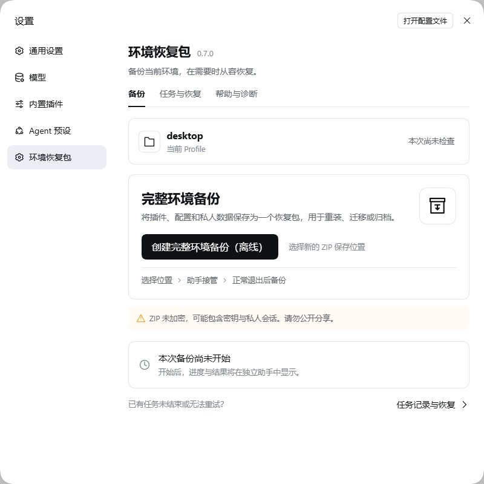
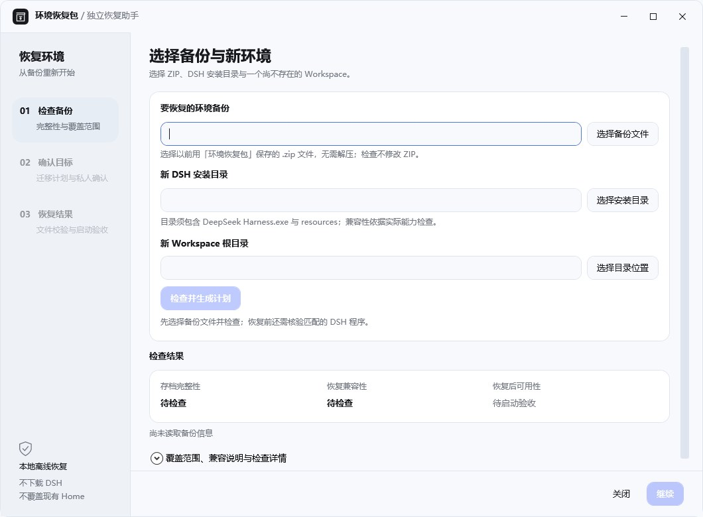

# DSH Environment Packer

**环境恢复包 · 给熟悉的 DSH 环境，留一份可以带走的备份。**

[](https://github.com/379385796-sys/dsh-environment-packer/releases/tag/v0.7.0)

[](LICENSE)

[下载 v0.7.0](#下载与安装) · [快速上手](#备份与恢复) · [完整文档](#文档与反馈) · [English](README.en.md)

升级前留一份备份，重装或迁移时少一些从头配置。Packer 将当前 Profile 的插件、设置和支持的会话数据收进私人离线归档，再由独立助手引导你在新环境恢复。保存了什么、检查到哪一步、哪些问题需要处理，都有清楚的结果可查。

## 为你的环境保留什么

- **插件与配置一起保存**：收录当前 Profile 的已安装插件、依赖载荷和配置，保留熟悉的环境组成。
- **延续工作上下文**：覆盖 Session、Workspace 登记，以及已识别的记忆、Skills、插件状态和支持的客户端偏好。
- **有引导的冷备份**：独立助手接管后，正常退出 DSH，再完成采集与校验；已有 ZIP 不覆盖。
- **适应新的保存位置**：为新环境安排目录与已识别的路径映射，无需沿用旧电脑的相同路径。
- **DSH 无法启动时也有入口**：完整独立恢复工具可单独打开，使用已安装的兼容 DSH 检查与恢复。
- **结果可以核对**：查看任务记录、文件摘要与检查结论；关键缺口或兼容问题会明确显示。

**v0.7.0 亮点**：更连贯的页面与操作反馈、更清楚的恢复诊断，并支持减少动态效果。[查看本版说明 →](docs/RELEASE-0.7.0.md)

## 看看界面

在 DSH 设置中直接开始备份，任务记录与帮助各有归处。



<details>
<summary>查看独立恢复助手</summary>

选择备份、兼容的 DSH 安装目录和新的 Workspace，先检查计划，再确认恢复。



</details>

截图来自已发布 v0.7.0 的真实界面，在空的隔离环境中采集，不含私人会话或备份。

## 下载与安装

从 [v0.7.0 Release](https://github.com/379385796-sys/dsh-environment-packer/releases/tag/v0.7.0) 下载所需文件，并用同页的校验清单核对 SHA-256：

| 下载 | 用途 |
| --- | --- |
| [插件 TGZ](https://github.com/379385796-sys/dsh-environment-packer/releases/download/v0.7.0/dsh-environment-packer-0.7.0.tgz) | 安装到 DSH |
| [独立恢复工具 ZIP](https://github.com/379385796-sys/dsh-environment-packer/releases/download/v0.7.0/Packer-v0.7.0-Standalone-Recovery.zip) | 在需要恢复时单独使用；请保留完整目录 |
| [SHA256SUMS.txt](https://github.com/379385796-sys/dsh-environment-packer/releases/download/v0.7.0/SHA256SUMS.txt) | 核对下载文件 |

保存工作并正常退出全部 DSH 实例后，通过当前 Desktop 的官方插件管理流程安装 TGZ。已配置 CLI 时可用：

```text
dsh plugin --profile desktop add "<TGZ 绝对路径>" --offline --ignore-scripts
```

重新启动后，在 **设置 → 环境恢复包** 确认版本为 0.7.0。升级已有 Profile 请沿用原 pnpm store，保留旧版回退包；离线缓存准备与回退方法见 [升级指南](docs/UPGRADE-ROLLBACK.md)。

DSH Market 的 [v0.7.0 更新 PR](https://github.com/awesome-dsh-plugin/awesome-dsh-plugin/pull/13268) 仍待合并；目前可直接使用上面的正式 Release 下载。

## 备份与恢复

### 保存当前环境

1. 在 **设置 → 环境恢复包 → 备份** 选择一个新的 ZIP 保存位置，阅读并确认私人数据提示。
2. 等独立助手接管，再保存工作、正常退出全部 DSH 实例（包括托盘），回到助手确认继续。
3. 等待采集和校验完成，查看结果并妥善保存 ZIP。若显示“归档完成；恢复受阻”，保留归档，并按诊断处理已知问题。

### 在新环境恢复

1. 准备可信、兼容的 DSH 安装，并解压完整的独立恢复工具。运行 `Open-Recovery.ps1` 或 `package/bin/restore-assistant.exe`。
2. 选择备份 ZIP、DSH 安装目录和**尚不存在的新 Workspace 根目录**，检查自动生成的计划。
3. 核对范围并确认恢复。助手在隔离目录恢复与验证，通过依赖、数据及实际启动检查后才提交；完成后仍应核对自己的插件和业务数据。

不需要先启动日常使用的 DSH 来打开恢复助手。[详细恢复步骤与旧归档入口 →](docs/RESTORE.zh-CN.md)

## 支持范围与重要提醒

当前面向 **Windows x64**。已完成受控合成环境中的 DSH **0.2.1-rc.5 → 0.2.2-rc.1** 迁移验证；具体归档仍需检查目标宿主、依赖、ABI 与数据格式的兼容性。

- **备份范围**：当前 Profile 与已识别的 Home、记忆、Skills 等状态；`plugins-local` 源码排除 `node_modules`，恢复为数据，不激活。
- **需另行准备**：DSH 安装程序、外部模型、任意工程源码及未收录的外部资源。
- **容量上限**：单文件 128 MiB、总载荷 2 GiB、最多 60,000 条目；超限明确失败。恢复需额外可用空间预算，见 [容量说明](docs/BUILD-TEST.md)。

> **私人 ZIP 未加密，可能包含密钥与私人会话。请保存在可信位置，不要公开上传。** 只使用可信归档与完整工具包。

文件完整性通过不等于私人业务恢复认证。完整真实插件组合、原生 Mnemon、私人数据库/凭据及跨设备迁移等仍有未验证边界；未知关键数据或未解决的兼容问题会阻止完整恢复。旧归档不会因升级插件自动修复。详见 [兼容性与验收边界](docs/COMPATIBILITY.md)；运行时限制也不是恶意插件的操作系统沙箱。

## 文档与反馈

- **准备与恢复**：[准备清单](docs/RECOVERY-PREPARATION.md) · [恢复指南](docs/RESTORE.zh-CN.md) · [迁移细节](docs/MIGRATION.md)
- **支持与维护**：[兼容范围](docs/COMPATIBILITY.md) · [升级与回退](docs/UPGRADE-ROLLBACK.md) · [卸载与清理](docs/CLEANUP.md)
- **版本与记录**：[CHANGELOG](CHANGELOG.md) · [v0.7.0 说明](docs/RELEASE-0.7.0.md) · [全部 Releases](https://github.com/379385796-sys/dsh-environment-packer/releases)
- **问题与建议**：[提交 Issue](https://github.com/379385796-sys/dsh-environment-packer/issues)

采用 [MIT License](LICENSE)。欢迎分享使用建议；反馈时请勿附上私人 ZIP、凭据或未脱敏日志。
